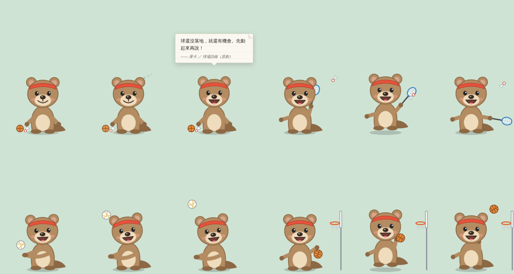

# 庫卡（Quokka Pet）

一隻住在桌面上的短尾矮袋鼠「庫卡」，用 **Electron + Node** 製作。牠會打羽球、排球、籃球，也會陪你工作：監看資料夾變化、連接 AI 聊天、追蹤今日工作進度。

這是獨立專案，有自己的 `package.json`，與上層資料夾的「桌面大師」互不相依；設定檔也分開存放。



## 安裝與執行

需求：Node.js 18+。請在 **本資料夾（`quokka-pet/`）** 內執行：

```bash
npm install
```

```bash
npm start
```

啟動後桌寵出現在螢幕右下角。拖曳可移動，點一下開啟／關閉控制面板，右鍵讓牠說一句話。

## 功能

### 桌寵與運動
- 透明、無邊框、永遠置頂的小視窗；造型為純 inline SVG，不使用任何外部圖檔。
- 姿勢由 `#pet` 的 `data-pose` 控制：
  - `idle`：呼吸、眨眼、偶爾揮手。
  - `think`：等待 AI 回覆時傾頭、冒出「…」。
  - `happy`：勾選完成任務時歡呼彈跳。
  - `badminton`：右手揮拍，把飛來的羽球殺回去。
  - `volleyball`：雙手低手墊球。
  - `basketball`：運球三下後起跳，投進右側籃框。
- 待機時每隔 20–40 秒自動輪流打一項球（正在說話、思考或被拖曳時略過該輪）；也可到「設定 → 讓庫卡打球」手動指定。每段約 4.8 秒，打完會說一句話。
- 系統開啟「減少動態效果」時不會自動打球。

### 語錄
- `data/quotes.json`：6 則原創打氣語＋4 則短尾矮袋鼠生態小知識，**皆非引用名言**。
- 依設定間隔（預設 20 分鐘）以氣泡說一句；右鍵桌寵或在「語錄」分頁點選可立即說。

### 資料夾監看（唯讀）
- 以系統對話框挑選資料夾，用 chokidar 監看；有檔案新增／修改／刪除時跳出氣泡，面板列出近期變更。
- **只監看與通知，絕不刪除、搬移或改名任何檔案。**

### AI 聊天
- 可插拔供應商（`providers/`），內建 OpenAI 相容 HTTP 供應商與一個佔位用的 stub。
- 人格為開朗的短尾矮袋鼠「庫卡」，一律以繁體中文回覆（見 `renderer/characters.js` 的 `persona`）。
- 可勾選「帶上近期資料夾變更作為上下文」。

### 工作進度
- 任務清單（新增、勾選、刪除），定時提醒目前進度（預設 30 分鐘）。

## 設定

環境變數優先於 app 內設定：

| 變數 | 說明 | 範例 |
| --- | --- | --- |
| `OPENAI_API_KEY` | API 金鑰 | `sk-...` |
| `OPENAI_BASE_URL` | API Base URL | `https://api.openai.com/v1` |
| `OPENAI_MODEL` | 模型名稱 | `gpt-4o-mini` |

app 內設定存於 `<userData>/config.json`（Windows 約在 `%APPDATA%/quokka-pet`，Linux 約在 `~/.config/quokka-pet`），不會進入 repo。**金鑰絕不提交。**

## 專案結構

```
quokka-pet/
├── package.json
├── main.js                 # 主行程：視窗、IPC、資料夾監看、設定、提醒、語錄、AI 呼叫
├── preload.js              # contextBridge 暴露的最小化 API
├── data/quotes.json        # 原創打氣語與生態小知識
├── providers/              # AI 供應商（OpenAI 相容、stub）
├── renderer/
│   ├── characters.js       # 庫卡的 SVG、問候語、運動清單、AI 人格
│   ├── pet.html / pet.css / pet.js       # 桌寵視窗（姿勢與運動動畫、氣泡）
│   └── panel.html / panel.css / panel.js # 控制面板
└── preview/quokka-sports.png             # 各姿勢畫格（文件用）
```

安全性：`contextIsolation: true`、`nodeIntegration: false`，renderer 只能透過 `window.api` 與主行程溝通。

## 想調整的話

- 造型：改 `renderer/characters.js` 裡的 SVG。運動道具預設以 `display="none"` 隱藏，由 `pet.css` 依姿勢顯示。
- 動畫：改 `renderer/pet.css` 的 `bd*`（羽球）、`vb*`（排球）、`bb*`（籃球）關鍵影格；每段總長需與 `pet.js` 的 `SPORT_MS` 一致。
- 自動打球頻率：`renderer/pet.js` 的 `scheduleSport()`。
