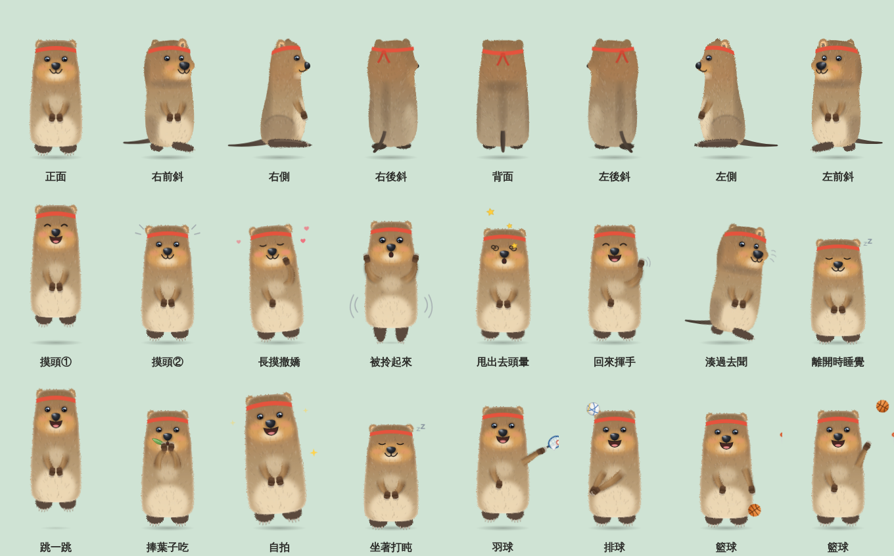

# 庫卡（Quokka Pet）

住在桌面上的短尾矮袋鼠「庫卡」，用 **Electron + Node** 製作的桌面寵物兼工作助理。**工作為主、動作是趣味**：一個輸入框就能新增待辦、提醒、股票和資料夾，交給不同的庫卡各自盯著；有事時牠會跳出來報告。閒下來時牠們會散步、打球、互相打招呼，甚至談戀愛、生小袋鼠。

不做 AI 聊天，也不需要任何金鑰。

這是獨立專案，有自己的 `package.json`，與上層資料夾的「桌面大師」互不相依；設定檔也分開存放。完整的互動規格見 [`docs/interaction-logic.md`](docs/interaction-logic.md)。



## 安裝、執行、測試

需求：Node.js 18+。請在 **本資料夾（`quokka-pet/`）** 內執行：

```bash
npm install
npm start      # 啟動
npm test       # 單元測試（Node 內建 test runner，不開視窗；目前 160 項）
```

啟動後庫卡出現在主螢幕下方。**點一下＝摸頭，點兩下＝打開面板並切到那隻**，拖曳可移動（放下的位置就是牠的家），右鍵開選單。程式只能開一個；**再開一次程式**會把藏起來的庫卡叫回來並打開面板。

## 功能

### 一個輸入框新增所有東西

在面板的輸入框打字，框的下方即時顯示判斷結果（例如「→ 今天 15:30 提醒」，有推斷時附提示），按 Enter 交給目前選的那隻；判斷錯了可以點提示改類型。

| 你打的 | 結果 |
|---|---|
| `2330`、`00878`、`2330.TW`、`6488.TWO`、`2330 台積電`、`台積電` | 台股（先向證交所查證；有打名稱時會核對名稱） |
| `AAPL`、`aapl`、`BRK.B` | 美股（`BIM`、`CAD`、`PDF`、`RC` 這類建築與辦公縮寫不算） |
| `30分 泡茶`、`30分泡茶`、`2小時後回電`、`半小時後打給技師`、`5分鐘後` | N 分鐘後提醒一次（沒內容時是「時間到了」） |
| `15:30 開會`、`下午3點半 開會`、`三點一刻開會`、`開會 15:30` | 今天該時間提醒；已過就改明天並提示 |
| `明天 10:00 看工地`、`明早9點交圖`、`下週一10點業主簡報`、`12/5 10點 驗收` | 該日提醒 |
| `每天 17:00 起來動一動`、`每週一三五 8:30 運動`、`平日9點打卡`、`每週末 10點 爬山` | 重複提醒 |
| `3點前交圖`、`週五前送審` | 截止型：提早 30 分鐘提醒；只寫日期的就當天 09:00 |
| `9點~10點 開會` | 用開始時間提醒，內容保留「（9:00–10:00）」 |
| `提醒我下午3點開會`、`記得下午4點打給營造廠` | 去掉前綴再判斷 |
| `D:\工地\照片`、`/home/me/報價`（存在的資料夾） | 監看資料夾 |
| 其他，例如 `回覆業主信件`、`3000 訂金`、`記得買牛奶` | 待辦 |

沒寫上下午時會依內容和現在時刻推斷：例如下午打「3點 開會」是今天 15:00，「8點吃晚餐」是 20:00，「明天3點出發」當成下午並提示「凌晨請寫凌晨3點」。完整規則見規格第 3.1 節。

### 很多隻庫卡，每隻盯自己的事
- 面板名單：「全部」＋每一隻（紅點是牠負責幾件事）＋「＋」新增。超過 6 隻時顯示最近 6 隻和「更多…」（可以搜尋名字）。
- 每筆待辦、提醒、股票、資料夾都有負責的那隻；可以拖到頭像上或右鍵「交給…」換人。小袋鼠還不能接任務。
- 所有庫卡畫在一層全螢幕透明「舞台」裡（目前只在主螢幕），平常滑鼠穿透，游標碰到庫卡才能點，不擋工作。

### 提醒
- 只設一個計時器，到時間才醒來；每 60 秒檢查一次系統時間或時區有沒有被改。
- 響鈴時負責的那隻跳出來響鈴，按「知道了」或「5 分後」（貪睡）；也會發系統通知，2 秒內的多則合併成一則。
- 程式沒開或電腦睡眠而錯過的，只報一次「錯過」（不響鈴），面板標「錯過」直到你按「知道了」。

### 股價
- 台股用證交所即時資訊、美股用 Yahoo，依交易時間自動調整查詢頻率；抓不到時自動退避，面板顯示「暫停更新」。
- 漲跌每多跨一個門檻（預設 1%，可設 1／2／3%）牠才反應一次：往上歡呼、往下垂頭。跨回要多退 0.2 個百分點，同一檔 60 秒冷卻。
- **今天發生了什麼**：點面板上的股票卡片，或右鍵「今天股市怎麼了？」，負責的那隻會用自己的個性和短尾矮袋鼠的比喻，講今天的技術指標（均線、RSI、MACD、KD、布林通道、量比…）。只描述已經發生的事，不預測、不建議買賣。收盤後也會自動講一次精簡版。
- 僅供參考，不是投資建議；資料可能延遲。

### 資料夾監看（唯讀）
- 用 chokidar 監看（深度 4 層，忽略隱藏檔），5 秒內的變動合併成一次報告：「XX 資料夾有 3 個檔案變了」。
- **只監看與通知，絕不刪除、搬移或改名任何檔案。**

### 離開與回來
- 預設 5 分鐘沒碰鍵盤滑鼠，或鎖定螢幕，就算離開：庫卡睡覺，有事先記著（提醒照樣響）。回來時有事的那幾隻依序揮手報告。
- 右鍵「暫時藏起來 30 分鐘」：全部藏起來；有提醒要響時會自己回來。

### 互動與動作
| 你做什麼 | 庫卡的反應 |
| --- | --- |
| 點一下 | 摸頭，依個性反應（單擊會等約 0.25 秒確認不是雙擊） |
| 點兩下 | 打開面板並切到牠；還沒取名的小袋鼠會開取名框 |
| 游標在頭上來回移動 | 長摸撒嬌；摸超過 8 秒會睡著 |
| 游標靠近（400 px 內） | 看向游標 |
| 拖曳 | 被拎起來；甩得快會頭暈，慢慢放就跳一下 |
| 右鍵 | 說一句話、今天股市怎麼了？、陪我玩（羽球、排球、籃球、吃葉子、跳一跳、打盹）、打開面板、暫時藏起來 30 分鐘、結束 |

- 自己會散步（家附近 ±400 px，可設成整個螢幕或不散步）、做小動作；打籃球、排球時球真的丟到桌面上，有重力和反彈，停下後牠會去撿回來。
- 系統開啟「減少動態效果」（或 ⚙ 動作減少設成開）時不散步、不自動互動。
- 「說一句話」從 `data/quotes.json` 挑一句：6 則原創打氣語＋9 則短尾矮袋鼠生態小知識，**皆非引用名言**。沒有定時自動說話。

### 個體特徵、個性、飾品
- 每隻在真實範圍內隨機產生：性別、年齡、頭身長、尾長、體重、胖瘦、毛色等（範圍依據：西澳政府 DBCA 物種資料、澳洲博物館、Animal Diversity Web）。
- 個性五個面向（活潑、親人、膽量、好奇、黏人）決定個性類型（運動健將、黏人開心果、害羞小可愛、好奇探險家、慵懶睡神、獨立酷酷派、隨和好夥伴）、社交風格、最愛與不太愛的活動、嗜好。
- 12 種飾品（頭帶、蝴蝶結、草帽、工地安全帽…），3D 跟著頭轉；⚙ 可以換種類和顏色。
- 十六方位 3D 代理模型，轉身時角度連續變化。

### 社交、戀愛與家族
- 同一地面、距離夠近的兩隻會互相打招呼、碰鼻、分享葉子、一起打羽球；好感度累積，達 80 成為好朋友（不分性別）。
- 一公一母、都成年、好感度 100、不是近親，就會成為一對；之後可能懷孕（遊戲時間 27 分鐘），生下小袋鼠，先在育兒袋裡，再跟著媽媽，最後長大獨立。
- ⚙ 可以關掉戀愛系統或寶寶出生。

## 設定檔

設定存於 `<userData>/config.json`（Windows 約在 `%APPDATA%/quokka-pet`，Linux 約在 `~/.config/quokka-pet`），不會進入 repo。原子寫入；檔案壞掉時會先另存備份，不會被預設值蓋掉。

## 專案結構

```
quokka-pet/
├── main.js                  # 進入點（只允許開一個），主要邏輯在 lib/app-v2.js
├── stage-preload.js         # 舞台的 preload（只開放舞台需要的通道）
├── panel-preload.js         # 面板的 preload
├── lib/
│   ├── app-v2.js            # 主行程：資料、提醒、股價、資料夾、離開偵測、面板、右鍵選單、通知
│   ├── store.js             # 資料儲存（schema v2、v1 遷移、原子寫入、壞檔備份）
│   ├── parse-input.js       # 輸入框判斷（主行程與面板共用）
│   ├── reminders.js         # 提醒排程、錯過、時鐘跳動、通知合併、離開期間報告
│   ├── stock-service.js     # 台股／美股報價
│   ├── stock-step.js        # 漲跌跨門檻（遲滯、冷卻）
│   ├── stock-history.js     # 日線歷史
│   ├── indicators.js        # 技術指標與訊號
│   ├── market-talk.js       # 把訊號翻成庫卡的話
│   ├── stage-main.js        # 舞台圖層（滑鼠穿透、游標偵測）
│   ├── social.js            # 社交配對（SocialDirector）
│   └── romance.js           # 好感度、成為一對、懷孕、出生、遺傳、長大
├── renderer/
│   ├── stage.html / stage.js / stage-*.js   # 舞台：每隻庫卡的狀態機、氣泡、球、雙人互動
│   ├── panel.html / panel.css / panel.js    # 面板
│   ├── traits.js            # 個體特徵與個性
│   ├── quokka-art.js / quokka-pose.js / quokka-anim.js / quokka-anim-social.js / quokka-acc.js  # 繪圖、姿勢、動畫、飾品
├── data/quotes.json         # 原創打氣語與生態小知識
├── docs/interaction-logic.md  # 互動邏輯規格
├── scripts/                 # 連真實報價來源的手動測試（stock-smoke.js、market-talk-smoke.js）
├── test/                    # 單元測試
└── preview/quokka-poses.png # 各姿勢畫格（文件用）
```

安全性：`contextIsolation: true`、`nodeIntegration: false`，舞台和面板各用自己的 preload，所有請求由主行程驗證。只連兩個報價網站（`mis.twse.com.tw`、`query1.finance.yahoo.com`）。
